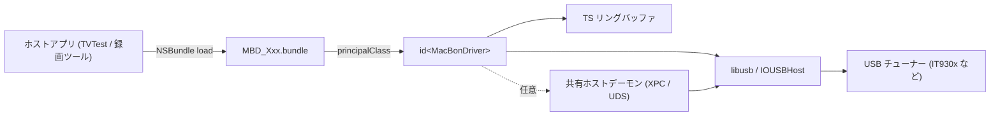
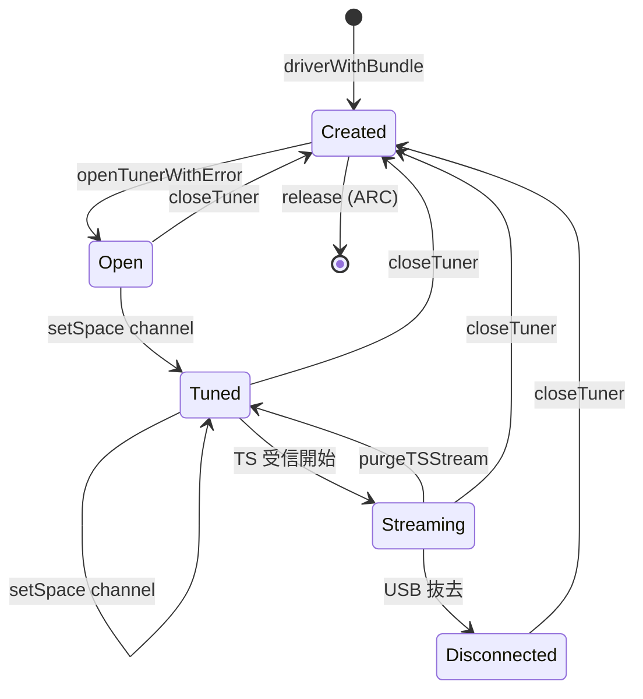

# MacBonDriver 仕様書 v1.0

macOS 上で USB 接続の地上・衛星・CATV デジタルチューナーを扱うため、ユーザーランドで動く
ドライバプラグインの仕様です。Windows の BonDriver（`IBonDriver` / `IBonDriver2` / `IBonDriver3`）と
同じ役割を、macOS の Loadable Bundle（`.bundle`）と Objective-C プロトコルで実現します。

- 公開ヘッダー: [`include/MacBonDriver.h`](../include/MacBonDriver.h)
- API バージョン: `MacBonDriverAPIVersion = 1`
- 対象 OS: macOS 12 以降（arm64 / x86_64）

---

## 1. 目的と設計方針

| 項目 | Windows BonDriver | MacBonDriver |
| --- | --- | --- |
| 配布形式 | `BonDriver_*.dll` | `MBD_*.bundle`（`CFBundlePackageType = BNDL`） |
| 読み込み | `LoadLibrary` + `CreateBonDriver()` | `NSBundle -loadAndReturnError:` + `principalClass` |
| インターフェース | C++ vtable（`IBonDriver2`） | Objective-C `@protocol MacBonDriver` |
| 拡張 | `IBonDriver3`（`dynamic_cast`） | オプションプロトコル（`conformsToProtocol:`） |
| 文字列 | `LPCTSTR`（UTF-16） | `NSString` |
| エラー | `BOOL` のみ | `BOOL` + `NSError`（`MBDErrorDomain`） |
| USB アクセス | WinUSB / カーネルドライバ | libusb または IOKit `IOUSBHost`（ユーザーランド） |
| 設定ファイル | `BonDriver_*.ini` / `.ChSet.txt` | バンドル内 `Resources/` またはユーザー上書き（§7） |

方針:

1. **カーネル拡張・DriverKit を不要にする。** USB はユーザーランドから libusb / IOKit で直接操作します。
2. **ホストはドライバの実装を知らない。** ホスト（TVTest macOS 版、録画ツール、配信サーバーなど）は
   `MacBonDriver` プロトコルだけに依存します。
3. **BonDriver との対応関係を保つ。** 既存の BonDriver 実装（例: px4_drv の `BonDriver_PX4`）を移植しやすいように、
   メソッドを 1 対 1 で対応付けます（§4.3）。
4. **TS 取得経路は C レベルのポインタで行う。** ストリーム取得はホットパスのため、
   `NSData` を生成せず `const uint8_t *` を返すメソッドを用意します。

---

## 2. 全体構成



### 2.1 動作モード

| モード | 説明 | 用途 |
| --- | --- | --- |
| **直接モード**（既定） | バンドル自身が USB インターフェースを claim | 単一アプリから 1 チューナーを使う |
| **ホスト経由モード** | バンドルは薄いクライアントで、常駐デーモンが USB を所有 | 複数アプリの同時利用、カードリーダー共有、WinUSB 版 `DriverHost_PX4` 相当 |

ホスト経由モードを使うバンドルは `Info.plist` の `MBDRequiresExternalHost` を `YES` にします。
ホスト側から見た API はどちらのモードでも同じです。

---

## 3. バンドル形式

### 3.1 ディレクトリ構成

```
MBD_SQR100.bundle/
└── Contents/
    ├── Info.plist
    ├── MacOS/
    │   └── MBD_SQR100              # Mach-O bundle (MH_BUNDLE), universal 推奨
    ├── Frameworks/                 # 任意: libusb-1.0.dylib など (@loader_path 参照)
    └── Resources/
        ├── MBD_SQR100.ChSet.plist  # チャンネル定義 (§7)
        ├── MBD_SQR100.Config.plist # ドライバ設定 (§7)
        └── firmware/
            └── it930x-firmware.bin
```

- 実行ファイルは `clang -bundle` で生成する `MH_BUNDLE` 形式とします。
- 依存 dylib を同梱する場合は `install_name_tool` で `@loader_path/../Frameworks/` を参照させます。
- 配布時はコード署名（`codesign --sign`）を推奨します。Hardened Runtime を有効にしたホストでは、
  ホストに `com.apple.security.cs.disable-library-validation` が必要になる場合があります（§10）。

### 3.2 命名規則

- バンドル名: `MBD_<ドライバ名>.bundle`（例: `MBD_SQR100.bundle`, `MBD_PX4-S.bundle`）
- **principal class とバンドル内の全クラスには一意な接頭辞を付けます。**
  Objective-C のクラス名はプロセス内で共有されるため、複数のドライバを同時に読み込むと
  同名クラスが衝突します（例: `MBDSQR100Driver`, `MBDSQR100RingBuffer`）。
- C 関数やグローバルシンボルは `static` にするか、`-fvisibility=hidden` でビルドします。

### 3.3 Info.plist

| キー | 型 | 必須 | 説明 |
| --- | --- | --- | --- |
| `CFBundlePackageType` | String | ○ | `BNDL` |
| `CFBundleIdentifier` | String | ○ | 逆ドメイン形式 |
| `CFBundleExecutable` | String | ○ | `MacOS/` 下の実行ファイル名 |
| `NSPrincipalClass` | String | ○ | `MacBonDriver` に準拠するクラス名 |
| `MBDAPIVersion` | Integer | ○ | 対応 API バージョン（`1`） |
| `MBDDisplayName` | String | ○ | ホストの一覧に表示する名前 |
| `MBDDriverIdentifier` | String | ○ | ホストの設定保存に使う ID（バンドル名変更の影響を受けない） |
| `MBDSupportedSystems` | Array<String> | ○ | `ISDB-T` / `ISDB-S` / `ISDB-C` / `ISDB-S3` |
| `MBDCapabilities` | Array<String> | － | `MultiTuner` / `LNB` / `TSMF` / `SmartCard` / `Hotplug` |
| `MBDUSBMatchList` | Array<Dict> | － | `{VendorID, ProductID}` の一覧。ホストのデバイス自動選択に使う |
| `MBDRequiresExternalHost` | Boolean | － | ホスト経由モードなら `YES` |
| `MBDConfigFileName` | String | － | 設定ファイル名の基底（省略時はバンドル名） |

ホストはバンドルの実行ファイルを読み込む**前に** `Info.plist` を読み、`MBDAPIVersion` と
`MBDSupportedSystems` で候補を絞り込めます。

---

## 4. コアプロトコル `MacBonDriver`

### 4.1 生成

```objc
+ (NSUInteger)apiVersion;
+ (nullable instancetype)driverWithBundle:(NSBundle *)bundle
                                  options:(nullable NSDictionary<MBDDriverOptionKey, id> *)options
                                    error:(NSError **)error;
```

- ホストは `apiVersion` が `MacBonDriverAPIVersion` と一致することを確認してから生成します。
  メジャーな非互換が入った場合のみ API バージョンを上げます。オプションメソッドの追加では上げません。
- `driverWithBundle:` では**USB デバイスを開きません。** 設定・チャンネル定義の読み込みだけを行い、
  `tuningSpaceNameAtIndex:` などの列挙をチューナー未接続でも答えられる状態にします。
- 1 インスタンスは 1 論理チューナーに対応します。複数チューナーを使うホストは複数インスタンスを生成し、
  `MBDOptionDeviceIndexKey` などでデバイスを指定します。

| オプションキー | 型 | 説明 |
| --- | --- | --- |
| `MBDOptionConfigURL` | NSURL / NSString | 設定・チャンネル定義の上書きパス |
| `MBDOptionFirmwareDirectoryURL` | NSURL / NSString | ファームウェア格納ディレクトリ |
| `MBDOptionUSBDeviceLocationID` | NSNumber | IOKit `locationID` で物理デバイスを固定 |
| `MBDOptionUSBSerialNumber` | NSString | シリアル番号で物理デバイスを固定 |
| `MBDOptionDeviceIndex` | NSNumber | 0 起点の論理デバイス番号 |
| `MBDOptionHostEndpoint` | NSString / NSURL | ホスト経由モードの接続先 |

### 4.2 ライフサイクル



- `closeTuner` は冪等で、どの状態から呼んでもよいものとします。
- インスタンスの解放（ARC による `dealloc`）時、開いていれば `closeTuner` 相当を実行します。
  BonDriver の `Release()` に相当するメソッドはありません。
- `setSpace:channel:error:` は成功時に TS バッファを破棄します（`PurgeTsStream` 相当）。
  ストリーミングはチューニング成功後に自動で開始します。

### 4.3 BonDriver との対応表

| IBonDriver / IBonDriver2 / IBonDriver3 | MacBonDriver |
| --- | --- |
| `CreateBonDriver()` | `+driverWithBundle:options:error:` |
| `OpenTuner()` | `-openTunerWithError:` |
| `CloseTuner()` | `-closeTuner` |
| `SetChannel(BYTE)` | なし（廃止。space/channel 形式のみ） |
| `GetSignalLevel()` | `signalLevel`（詳細は `-signalStatistics`） |
| `WaitTsStream(DWORD)` | `-waitTSStreamWithTimeoutMs:` → `MBDWaitResult` |
| `GetReadyCount()` | `-readyStreamCount` |
| `GetTsStream(BYTE*, ...)` | `-readTSStreamIntoBuffer:capacity:bytesRead:remainingCount:error:` |
| `GetTsStream(BYTE**, ...)` | `-getTSStreamChunk:length:remainingCount:error:` |
| `PurgeTsStream()` | `-purgeTSStream` |
| `Release()` | ARC による解放 |
| `GetTunerName()` | `tunerName` |
| `IsTunerOpening()` | `tunerOpen` |
| `EnumTuningSpace(DWORD)` | `-tuningSpaceNameAtIndex:` |
| `EnumChannelName(DWORD, DWORD)` | `-channelNameInSpace:channel:` |
| `SetChannel(DWORD, DWORD)` | `-setSpace:channel:error:` |
| `GetCurSpace()` / `GetCurChannel()` | `currentSpace` / `currentChannel` |
| `GetTotalDeviceNum()` | `MacBonDriverMultiTuner.totalDeviceCount` |
| `GetActiveDeviceNum()` | `MacBonDriverMultiTuner.activeDeviceCount` |
| `SetLnbPower(BOOL)` | `MacBonDriverLNBControl -setLNBPowerMode:error:` |

### 4.4 チャンネル列挙

- space / channel はいずれも 0 起点で連続した番号とします。
- `tuningSpaceNameAtIndex:` が `nil` を返した位置で space の列挙を終えます。
- `channelNameInSpace:channel:` が `nil` を返した位置でその space のチャンネル列挙を終えます。
- 未選局時の `currentSpace` / `currentChannel` は `MBDInvalidIndex`（`NSNotFound`）です。

### 4.5 信号レベル

- `signalLevel` は **CNR（dB）** を `float` で返します。ロックしていない場合や取得できない場合は `0.0f` です。
  これは px4_drv 系 BonDriver の慣例（CNR を返す）に合わせたものです。
- 詳細値は任意メソッド `-signalStatistics` で返します（`cnr_db`, `rssi_dbm`, `locked`, `ber`,
  `dropped_chunks`, `usb_error_count`）。
- `signalLevel` の取得で USB 転送が必要な場合、ドライバは結果をキャッシュし、200 ms 以上の間隔で更新して構いません。
  TS 受信スレッドを止めてはいけません。

### 4.6 TS ストリーム

#### チャンク

- 「チャンク」は USB バルク転送などの単位でまとめた TS データの塊です。
- 通常モードでは、各チャンクは **188 バイトの整数倍**で、先頭は同期バイト `0x47` とします。
  USB 転送の境界で TS パケットが分断されても、ドライバ側で再同期して整列したチャンクを返します
  （px4_drv の `remain_buf` 処理と同じ責務）。
- 推奨チャンクサイズは 188 × 816 = 153,408 バイト前後です。ホストはサイズを仮定してはいけません。
  `readTSStreamIntoBuffer:` を使うホストは 256 KiB 以上のバッファを用意することを推奨します。

#### 待機

```objc
- (MBDWaitResult)waitTSStreamWithTimeoutMs:(uint32_t)timeoutMs;
```

| 戻り値 | 意味 |
| --- | --- |
| `MBDWaitResultReady` | 1 チャンク以上読み出せる |
| `MBDWaitResultTimeout` | タイムアウト |
| `MBDWaitResultClosed` | `closeTuner` または `purgeTSStream` で待機が解除された |
| `MBDWaitResultError` | USB 抜去など回復不能なエラー |

`timeoutMs == 0` はポーリング（ブロックしない）です。

#### ゼロコピー取得

```objc
- (BOOL)getTSStreamChunk:(const uint8_t **)outBytes length:(NSUInteger *)outLength
          remainingCount:(NSUInteger *)outRemaining error:(NSError **)error;
```

- 返したポインタは、同じスレッドから次に `getTSStreamChunk:` / `readTSStreamIntoBuffer:` /
  `purgeTSStream` / `closeTuner` を呼ぶまで有効でなければなりません。
- データがない場合は `YES` を返し、`*outLength = 0` とします（BonDriver と同じ挙動）。
  エラー時のみ `NO` を返します。

#### コピー取得

`readTSStreamIntoBuffer:` は次のチャンクを丸ごとコピーします。`capacity` が足りない場合は
`MBDErrorBufferTooSmall` を返し、チャンクは消費しません。

#### バッファ溢れ

リングバッファが満杯になった場合、ドライバは**古いチャンクを捨てて**新しいチャンクを保持します。
破棄したチャンク数は `dropped_chunks` で数え、`MBDEventStreamOverflow` を通知できます。

### 4.7 スレッドモデル

| 呼び出し | スレッド |
| --- | --- |
| 生成・`openTuner`・`closeTuner`・`setSpace`・列挙 | 任意の 1 スレッド（制御スレッド） |
| `waitTSStream`・`getTSStreamChunk`・`readTSStream`・`readyStreamCount` | 任意の 1 スレッド（受信スレッド） |
| `purgeTSStream`・`signalLevel`・`signalStatistics` | どちらからでも可 |
| デリゲート通知 | ドライバ内部のバックグラウンドキュー |

- ドライバは、制御スレッドと受信スレッドからの**同時呼び出し**に対して安全でなければなりません。
- 同じ種類のスレッドを複数使った呼び出し（受信スレッド 2 本など）はサポート対象外です。
- `closeTuner` / `purgeTSStream` は、受信スレッドで `waitTSStream` がブロックしていても
  **デッドロックせずに**完了し、待機を `MBDWaitResultClosed` で解除しなければなりません
  （px4_drv `20260725_ringbuffer_purge_deadlock.md` の事例を参照）。
- メインスレッドを要求してはいけません。ホストがメインスレッドから呼ぶことも、呼ばないこともあります。
- デリゲートから UI を更新するホストは、自分でメインキューへディスパッチします。

### 4.8 エラー

すべての失敗系メソッドは `MBDErrorDomain` の `NSError` を返します。下位層のエラー
（libusb のエラー、`IOReturn`、POSIX `errno`）は `NSUnderlyingErrorKey` に入れます。

| コード | 主な状況 |
| --- | --- |
| `MBDErrorDeviceNotFound` | 対象 VID/PID のデバイスがない |
| `MBDErrorDeviceBusy` | 他プロセスがインターフェースを claim 済み |
| `MBDErrorDeviceDisconnected` | 使用中に抜去された |
| `MBDErrorFirmwareMissing` / `LoadFailed` | ファームウェアがない・転送失敗 |
| `MBDErrorInvalidSpaceOrChannel` | 範囲外の space/channel |
| `MBDErrorTuneFailed` / `TuneTimeout` | 選局失敗・ロックしない |
| `MBDErrorNotOpen` | 未オープンでの操作 |
| `MBDErrorBufferTooSmall` | `readTSStreamIntoBuffer:` のバッファ不足 |

---

## 5. オプション拡張プロトコル

ホストは `[driver conformsToProtocol:@protocol(...)]` で対応を確認してから使います。
`Info.plist` の `MBDCapabilities` は、読み込み前に判断するための補助情報です。

### 5.1 `MacBonDriverMultiTuner`（IBonDriver3 相当）

- `totalDeviceCount` / `activeDeviceCount` / `-enumerateDevices`
- `enumerateDevices` は USB を開かずに列挙できること（IOKit のレジストリ検索で足ります）。
- 各要素の辞書は `index`, `name`, `vendor_id`, `product_id`, `location_id`, `serial_number`,
  `systems`, `in_use` を持ちます。ホストはここで得た `location_id` を `MBDOptionUSBDeviceLocationID` に渡して
  特定の物理デバイスを開けます。

### 5.2 `MacBonDriverLNBControl`

- `supportsLNBPower` が `NO` のハードウェア（例: XIT-SQR100 はアンテナ給電非対応）は、
  `-setLNBPowerMode:error:` で `MBDErrorLNBNotSupported` を返します。
- `MBDLNBPowerAuto` は「衛星系 space を選局したときのみ 15 V 給電」を意味します。
- `closeTuner` 時に LNB 給電は必ず停止します。

### 5.3 `MacBonDriverTSMF`（ISDB-S TSID / ISDB-C TSMF）

- `-setSpace:channel:streamID:error:` で、チャンネル定義の Stream ID を上書きして選局します。
- 既定動作では、チャンネル定義の `StreamID` に従ってドライバが TSMF を分離し、単一 TS を出力します。
- チャンネル定義の `Flags` に `RawTSMF` がある場合は、多重化されたままの TS を出力します。
  この場合ホストは `MBDChannelFlagRawTSMF` を見て、自前で TSMF 分離を行います。
- `-channelInfoForSpace:channel:` でシステム・周波数・帯域・Stream ID・フラグを返せます（コアの任意メソッド）。

### 5.4 `MacBonDriverSmartCard`（内蔵カードリーダー）

IT930x の UART 経由カードリーダーなど、チューナーに内蔵されたスマートカードスロットに
APDU レベルでアクセスするためのプロトコルです。macOS の PC/SC（CryptoTokenKit）へ公開する
ブリッジはこの仕様の範囲外で、ホストまたは別コンポーネントがこのプロトコルを使って実装します。

| メソッド | 説明 |
| --- | --- |
| `cardReaderName` | リーダー名 |
| `-openSmartCardWithError:` / `-closeSmartCard` | セッション開閉 |
| `-isCardPresent:atr:error:` | 挿入状態と ATR |
| `-resetSmartCardReturningATR:error:` | リセット（T=1 初期化を含む） |
| `-transmitAPDU:error:` | コマンド APDU → レスポンス APDU（SW1/SW2 を含む） |

実装上の必須事項:

- チューナーとカードが**同じ電源系統・同じ USB 制御エンドポイント**を共有する場合、
  どちらか一方でも開いている間は電源を保持し、制御転送をドライバ内部で直列化します
  （WinUSB 版 `XitSqr100Device` の `card_open_` / `receiver_open_` 管理と同じ）。
- T=1 のブロック送受信、IFSC/IFSD、再送、CRC/LRC はドライバ内部で処理し、ホストには APDU だけを見せます。
- 1 回の APDU は最大 512 バイト（WinUSB 版 `card_command::MAX_DATA_SIZE` に合わせる）とします。

### 5.5 ホットプラグ（`MacBonDriverDelegate`）

`MBDCapabilities` に `Hotplug` を含むドライバは、次のイベントを通知します。

| イベント | userInfo 例 |
| --- | --- |
| `MBDEventDeviceDisconnected` | `{"location_id": 0x01100000}` |
| `MBDEventDeviceReconnected` | `{"location_id": 0x01100000}` |
| `MBDEventSignalLockChanged` | `{"locked": YES}` |
| `MBDEventStreamOverflow` | `{"dropped_chunks": 12}` |
| `MBDEventSmartCardStateChanged` | `{"present": NO}` |
| `MBDEventError` | `{"error": NSError}` |

- 抜去を検出したら、ドライバは待機中の `waitTSStream` を `MBDWaitResultError` で解除します。
- 再接続後、ドライバは**自動で再オープンしません。** ホストが `closeTuner` → `openTunerWithError:` →
  `setSpace:channel:error:` をやり直します。
- 抜去検出には IOKit の `IOServiceAddMatchingNotification`（`kIOTerminatedNotification`）、
  または libusb の hotplug コールバックを使います。

---

## 6. USB アクセス

### 6.1 推奨実装

| 方式 | 長所 | 短所 |
| --- | --- | --- |
| libusb 1.0 | Linux 版 px4_drv と共通化しやすい | dylib の同梱・署名が必要 |
| IOKit `IOUSBHost` framework | 追加依存なし、macOS ネイティブ | macOS 専用コード |

どちらでも構いません。px4_drv の `itedtv_bus_operations`（`ctrl_tx` / `ctrl_rx` / `stream_rx` /
`start_streaming` / `stop_streaming`）を実装するアダプタを書けば、`it930x.c` / `cxd2856er.c` /
`cxd6866.c` などのデバイス層を共有できます（px4_drv の `PX4_MACOS_USERLAND` 定義）。

### 6.2 必須事項

- インターフェースの claim は `openTunerWithError:` で行い、`closeTuner` で必ず release します。
- 他プロセスが claim 済みなら `MBDErrorDeviceBusy` を返します。強制的に奪ってはいけません。
- ストリーム受信には複数の非同期バルク転送を常時キューに積みます（推奨: 5 本 × 153,408 バイト）。
  受信コールバックではリングバッファへの書き込みだけを行い、重い処理をしません。
- ファームウェアは `MBDOptionFirmwareDirectoryURL` → バンドル内 `Resources/firmware/` →
  `~/Library/Application Support/MacBonDriver/firmware/` の順に探します。
- macOS のサンドボックス化されたホストから使う場合、ホストに
  `com.apple.security.device.usb` entitlement が必要です。

### 6.3 参考: XIT-SQR100

| 項目 | 値 |
| --- | --- |
| VID / PID | `0x06B8` / `0x106B` |
| ブリッジ | ITE IT9303FN |
| 復調 / チューナー | Sony CXD2856ER / CXD6866AER |
| エンドポイント | Bulk OUT `0x02`（制御）、Bulk IN `0x81`（制御応答）、Bulk IN `0x84`（TS） |
| チューナー数 | 1（地上・衛星・CATV で共用） |
| LNB 給電 | なし |
| カードリーダー | 内蔵（IT930x UART） |

---

## 7. 設定・チャンネル定義

### 7.1 探索順

1. `MBDOptionConfigURL` で指定したファイル
2. `~/Library/Application Support/MacBonDriver/<MBDDriverIdentifier>/<ConfigFileName>.ChSet.plist`
3. バンドル内 `Resources/<ConfigFileName>.ChSet.plist`

`Config.plist`（ドライバ設定）も同じ順に探します。

### 7.2 ChSet.plist 形式

```xml
<dict>
  <key>Spaces</key>
  <array>
    <dict>
      <key>Name</key><string>UHF</string>
      <key>System</key><string>ISDB-T</string>
      <key>Channels</key>
      <array>
        <dict>
          <key>Name</key><string>UHF 13ch</string>
          <key>FrequencyKHz</key><integer>473143</integer>
          <key>BandwidthKHz</key><integer>6000</integer>
        </dict>
      </array>
    </dict>
    <dict>
      <key>Name</key><string>BS</string>
      <key>System</key><string>ISDB-S</string>
      <key>Channels</key>
      <array>
        <dict>
          <key>Name</key><string>BS01/TS0</string>
          <key>FrequencyKHz</key><integer>1049480</integer>
          <key>StreamID</key><integer>16400</integer>
        </dict>
      </array>
    </dict>
  </array>
</dict>
```

| チャンネルのキー | 型 | 説明 |
| --- | --- | --- |
| `Name` | String | 表示名（必須） |
| `FrequencyKHz` | Integer | 中心周波数（必須） |
| `BandwidthKHz` | Integer | 帯域（省略時はシステム既定） |
| `StreamID` | Integer | BS/CS の TSID、または TSMF 相対 TS 番号 |
| `Flags` | Array<String> | `TSMF` / `RawTSMF` / `CATV` |

space の `System` は `ISDB-T` / `ISDB-S` / `ISDB-C` / `ISDB-S3` のいずれかです。

### 7.3 Windows の ChSet.txt からの変換

既存の `BonDriver_*.ChSet.txt`（タブ区切り）は、変換ツールで ChSet.plist に変換できる形を想定しています。
ドライバが ChSet.txt を直接読むことも許可しますが、plist を正とします。

---

## 8. ホストの実装ガイド

### 8.1 ドライバの探索

ホストは次の順に `MBD_*.bundle` を探します。

1. `<App>.app/Contents/PlugIns/BonDriver/`
2. `~/Library/Application Support/MacBonDriver/Drivers/`
3. `/Library/Application Support/MacBonDriver/Drivers/`

### 8.2 読み込み手順

```objc
NSBundle *bundle = [NSBundle bundleWithURL:url];
NSNumber *declared = bundle.infoDictionary[MBDInfoAPIVersionKey];
if (declared.unsignedIntegerValue != MacBonDriverAPIVersion) { /* skip */ }

NSError *error = nil;
if (![bundle loadAndReturnError:&error]) { /* report */ }

Class cls = bundle.principalClass;
if (![cls conformsToProtocol:@protocol(MacBonDriver)] ||
    [cls apiVersion] != MacBonDriverAPIVersion) { /* report */ }

id<MacBonDriver> driver = [cls driverWithBundle:bundle options:nil error:&error];
```

### 8.3 受信ループ

```objc
dispatch_async(streamQueue, ^{
    while (running) {
        MBDWaitResult r = [driver waitTSStreamWithTimeoutMs:1000];
        if (r == MBDWaitResultError) break;
        if (r != MBDWaitResultReady) continue;
        const uint8_t *bytes; NSUInteger length, remain;
        do {
            if (![driver getTSStreamChunk:&bytes length:&length remainingCount:&remain error:NULL]) break;
            if (length) consume(bytes, length);
        } while (remain > 0);
    }
});
```

### 8.4 アンロード

`NSBundle -unload` は Objective-C クラスを含むバンドルでは安全に行えません。
ホストは**一度読み込んだバンドルをプロセス終了まで保持**します。ドライバを切り替える場合は、
古いドライバのインスタンスを解放するだけにします。

---

## 9. 適合性チェックリスト

ドライバは次を満たす必要があります。サンプルホスト（`mbd-host`）の `--conformance` で一部を自動確認できます。

- [ ] `Info.plist` に必須キーがすべてある
- [ ] principal class が `MacBonDriver` に準拠し、`apiVersion == 1`
- [ ] `driverWithBundle:` で USB を開かない
- [ ] 未オープンでも space/channel を列挙できる
- [ ] `closeTuner` を 2 回呼んでも問題ない
- [ ] `waitTSStream` 中に別スレッドから `closeTuner` / `purgeTSStream` を呼んでも 1 秒以内に戻る
- [ ] 通常モードのチャンク長が 188 の倍数で、先頭が `0x47`
- [ ] データがないとき `getTSStreamChunk:` が `YES` かつ `length == 0` を返す
- [ ] 範囲外の space/channel で `MBDErrorInvalidSpaceOrChannel` を返す
- [ ] 他プロセスが使用中のとき `MBDErrorDeviceBusy` を返す
- [ ] USB 抜去時に `waitTSStream` が `MBDWaitResultError` で戻る
- [ ] クラス名に一意な接頭辞があり、他のドライバと同時に読み込める

---

## 10. セキュリティ・配布

- ドライバは**復号済みでない放送 TS をそのまま出力する**ものとし、スクランブル解除は行いません。
  B-CAS カードへのアクセスは `MacBonDriverSmartCard` による APDU 中継に限定します。
- ホストが Hardened Runtime を有効にしている場合、別チームの署名を持つバンドルを読み込むには
  ホスト側に `com.apple.security.cs.disable-library-validation` が必要です。
- ダウンロードしたバンドルには quarantine 属性が付きます。Gatekeeper による拒否は、
  公証（notarization）済みのバンドルを配布することで避けます。
- ドライバはネットワーク通信を行ってはいけません（ホスト経由モードのローカル IPC を除く）。

---

## 11. 将来の拡張（v1 の範囲外）

- 純 C ABI（`MBDCreateDriver()` が関数テーブルを返す形式）による Swift/C/Rust ホストからの利用
- ISDB-S3（TLV/MMT）出力の正式サポート
- 複数 TS の同時出力（1 チューナーから複数 Stream ID）
- PC/SC（CryptoTokenKit `TKSmartCardSlot`）ブリッジの標準化
